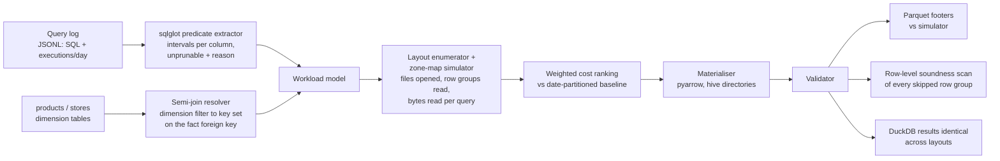

# prunewise

[](https://github.com/SlateGitOrg/prunewise/actions/workflows/ci.yml)


prunewise chooses a Parquet partition key, an in-file sort key and a row-group size for a retail fact table from the queries that are actually run against it. It parses a query log with sqlglot into per-column predicates, simulates zone-map pruning for every candidate layout without writing any data, and ranks the candidates by the bytes and file opens the workload would cost per day. The chosen layouts are then written with pyarrow and checked three ways: against the min/max statistics in the real Parquet footers, by re-scanning every skipped row group for a matching row, and by running every query in DuckDB on each layout and comparing the results. All data in this repository is synthetic and produced by a seeded generator.

## The problem

A grocery chain lands point-of-sale line items as Parquet and queries them from DuckDB and BI tools. The layout was chosen by habit: one file per day, rows in arrival order. The real workload filters mostly by region, product category and store, so most dashboards read nearly the whole lake. Rewriting a lake is expensive, so the layout should be chosen from evidence about the queries before any data is moved. The recommendation must also be safe: a layout model that skips a row group holding a matching row would make queries return wrong answers, so the pruning logic is checked for that explicitly.

## How it works



1. `analyze-workload` parses each logged query (DuckDB dialect). A column's predicate becomes a set of intervals: equality, `IN`, `BETWEEN` and comparison operators are intervals, conjunctions intersect them, and a disjunction on one column unions them. A disjunction across columns, `NOT`, `!=`, a function around a column, a null test or a `LIKE` with a leading wildcard is recorded as unprunable for that column with the reason, and does not restrict it.
2. A join to `products` or `stores` with a filter on a dimension attribute is resolved by evaluating the filter on the dimension in DuckDB; the matching keys become a restriction on the fact table's foreign key.
3. `rank` enumerates partition key (none, month, region, region + month, store + day) x sort key (none, date, product, store) x two row-group sizes. For each, the table is split into files and row groups by the same function the materialiser uses, min/max is computed per row group for the predicate columns, and each query gets files opened, row groups read and estimated bytes. Weighted cost is the sum over queries of `executions/day x (bytes read + file_open_cost x files opened)`.
4. `materialize` writes the baseline and the top layouts; `validate` checks them; `report` prints the ranking, a per-query breakdown and the unprunable predicates.

## Quick start

```bash
python -m venv .venv && . .venv/bin/activate
pip install -e ".[dev]"

prunewise generate --config demo --out data
prunewise analyze-workload --data data --out out/workload.json
prunewise rank --data data --workload out/workload.json --config demo --out out/ranking.json
prunewise materialize --data data --ranking out/ranking.json --out lake
prunewise validate --data data --lake lake --workload out/workload.json \
    --ranking out/ranking.json --out out/validation.json
prunewise report --ranking out/ranking.json --workload out/workload.json \
    --validation out/validation.json --top 6 --breakdown 1
```

`--config tests` uses 40,000 rows and row groups of 2,000 and 8,000 rows; `demo` uses 250,000 rows and row groups of 5,000 and 20,000. A TOML file can override any field of either preset (`--config my.toml`). `validate` exits with status 1 if any check fails.

## Example output

Output of the commands above on the seeded demo data (250,000 line items, 60 stores in 5 regions, 2,000 products in 12 categories, 90 days, 25 query templates). The transcript shows `generate`, `analyze-workload` and `rank`; the `materialize` and `validate` output is elided (`...`), and the tables are the output of `report`.

```text
$ prunewise generate --config demo --out data
wrote 250,000 line items and queries.jsonl to data/
$ prunewise analyze-workload --data data --out out/workload.json
25 queries, 2 unprunable predicates -> out/workload.json
$ prunewise rank --data data --workload out/workload.json --config demo --out out/ranking.json
32 layouts ranked, 8 excluded; best p_store_region-sale_month__s_product_id__rg5000 at 0.498 of baseline cost
...
```

Ranked layouts (cost ratio is weighted cost relative to the date-partitioned baseline):

| rank | layout | files | row groups | predicted bytes/day | cost ratio to baseline |
|---|---|---|---|---|---|
| baseline | `p_sale_date__s_none__rg20000` | 90 | 90 | 247.0 MiB | 1.000 |
| 1 | `p_store_region-sale_month__s_product_id__rg5000` | 15 | 59 | 171.5 MiB | 0.498 |
| 2 | `p_store_region__s_none__rg5000` | 5 | 52 | 224.3 MiB | 0.603 |
| 3 | `p_store_region__s_sale_date__rg5000` | 5 | 52 | 224.3 MiB | 0.603 |
| 4 | `p_sale_month__s_product_id__rg5000` | 3 | 52 | 235.2 MiB | 0.619 |
| 5 | `p_store_region__s_product_id__rg5000` | 5 | 52 | 235.9 MiB | 0.633 |
| 6 | `p_store_region-sale_month__s_none__rg5000` | 15 | 59 | 226.7 MiB | 0.639 |

Excluded layouts:

- partition `store_id+sale_date`: small-file rule: expected 5400 files (median about 46 rows) exceeds the limit of 2000 files

Per-query breakdown of the top layout (row groups read of the layout's total):

| query | executions/day | files opened | row groups read | bytes read |
|---|---|---|---|---|
| q01 | 70 | 1 | 5 of 59 | 67.9 KiB |
| q02 | 40 | 1 | 5 of 59 | 20.9 KiB |
| q03 | 70 | 1 | 4 of 59 | 53.5 KiB |
| q04 | 40 | 1 | 4 of 59 | 16.5 KiB |
| q05 | 70 | 1 | 4 of 59 | 50.1 KiB |
| q06 | 40 | 1 | 4 of 59 | 15.4 KiB |
| q07 | 70 | 1 | 4 of 59 | 55.6 KiB |
| q08 | 40 | 1 | 4 of 59 | 17.1 KiB |
| q09 | 70 | 1 | 4 of 59 | 51.1 KiB |
| q10 | 40 | 1 | 4 of 59 | 15.7 KiB |
| q11 | 40 | 15 | 15 of 59 | 241.0 KiB |
| q12 | 35 | 15 | 15 of 59 | 241.0 KiB |
| q13 | 25 | 5 | 5 of 59 | 88.9 KiB |
| q14 | 25 | 15 | 17 of 59 | 273.2 KiB |
| q15 | 20 | 15 | 28 of 59 | 449.9 KiB |
| q16 | 30 | 15 | 20 of 59 | 321.4 KiB |
| q17 | 25 | 5 | 6 of 59 | 106.7 KiB |
| q18 | 40 | 5 | 17 of 59 | 215.6 KiB |
| q19 | 30 | 5 | 21 of 59 | 263.0 KiB |
| q20 | 30 | 5 | 21 of 59 | 263.0 KiB |
| q21 | 40 | 15 | 59 of 59 | 500.0 KiB |
| q22 | 30 | 15 | 59 of 59 | 418.0 KiB |
| q23 | 30 | 15 | 59 of 59 | 151.6 KiB |
| q24 | 30 | 15 | 59 of 59 | 34.4 KiB |
| q25 | 20 | 15 | 59 of 59 | 2.0 MiB |

Unprunable predicates on the fact table:

| query | column | reason |
|---|---|---|
| q24 | `promo_code` | leading wildcard LIKE |
| q25 | `sale_ts` | function on column |

Validation of the baseline and the top three layouts:

| check | result |
|---|---|
| layouts validated | 4 |
| queries per layout | 25 |
| row groups re-scanned with Polars | 3490 |
| soundness violations | 0 |
| simulator-vs-footer mismatches | 0 |
| DuckDB result mismatches | 0 |
| extractor violations (real match outside model) | 0 |

## Design decisions

**One interval-set representation for every predicate.** Equality sets, `IN` lists, open and closed ranges, intersections and unions are all sets of intervals, and a row group can be skipped exactly when its `[min, max]` intersects none of them. This keeps the pruning test to one function. Integer-like columns (ids, dates as epoch days) are discrete, so `> 5` becomes `>= 6` and adjacent values merge: a category's block of product ids resolves to a single range. The cost is that the model cannot express anything that is not a union of intervals, which is why `NOT`, `!=` and functions are left out rather than approximated.

**Only necessary conditions are used.** For an `OR`, a column stays restricted only if every branch restricts it; for an `AND`, a conjunct that cannot be modelled is dropped and its column is noted as unprunable. The result is always a looser condition than the query, so a wrong or missing rule costs performance and never correctness. The price is some missed pruning, such as `store_id = 3 OR sale_date > ...`.

**The simulator and the writer share one split function; the validator reuses the simulator on real footers.** Sorting and row-group cutting live in `plan.py` and are called by both the simulator and the materialiser. The pruning function in `zonemap.py` runs over statistics either computed from the plan or read from Parquet footers, so a footer comparison is an exact comparison of row-group sets rather than a tolerance check. The trade-off is that a bug in that shared pruning function would appear in both; the soundness scan and the DuckDB comparison exist to catch that independently.

**A month partition is a transform of the date column.** `sale_month` prunes from date predicates through the month's first and last day, as hidden partitioning does in table formats such as Iceberg. A plain Hive reader would not derive that, so for such engines the month layouts are optimistic. Files whose partition values cannot match are never opened; files that survive partition pruning count as opened even if every row group is skipped, because the footer must be read.

**Bytes come from one reference write, and the file-open cost is a parameter.** Bytes per row for each column are measured once from a single compressed write of the table, and a query pays rows in each row group read times the bytes per row of the columns it references. Compression gains from sorting are therefore not modelled, which slightly understates the benefit of sorted layouts. The file-open cost is expressed in bytes and set relative to the size of the toy files (4 KiB in `demo`, about a tenth of a daily file); the ranking depends on that ratio, and a real lake would set it from measured request latency and throughput.

**Small files are excluded or penalised, not ignored.** A candidate whose expected file count exceeds `max_files` is excluded with the reason recorded (store x day would write 5,400 files). A candidate whose median file is below `min_file_rows` stays in but pays a per-file listing cost on every execution.

**Soundness is checked against two independent references.** The real SQL is rewritten to return the `sale_id` of every row it reads and run in DuckDB; the extracted model is also evaluated as a Polars expression. The model must contain every truly matching row, and no row group the simulator skips may contain a row of either. The re-scan reads skipped row groups from the materialised files.

Known limits: ties are possible (in the demo data, sorting by date and keeping arrival order give the same row-group counts and bytes at 5,000-row groups, so those two layouts tie and are ordered by name); only the `products` and `stores` dimensions are pushed down; and joins other than inner joins on the dimension key are treated as unprunable.

## Testing

```bash
pytest -q
```

The suite generates the 40,000-row tests dataset once and runs the whole pipeline on it. It checks predicate extraction on fixtures (range plus set, union on one column, cross-column `OR`, `NOT`, `!=`, functions, `LIKE`), semi-join pushdown against the generator's category blocks, the simulator on a hand-built file of 8 row groups with known min/max, the small-file rule, cost linearity in frequency (doubling frequencies doubles every cost and keeps the ranking; a zero-frequency query changes nothing), and that the top layout partitions on `store_region` and costs less than the baseline. The validation tests assert zero skipped row groups containing a matching row across all 41 layouts and 25 queries, exact equality between simulated row groups and real footers for three materialised layouts, identical DuckDB results across the baseline and those layouts, and that the checks fail when a forged skip or a tampered file is introduced. Everything runs offline.

## Project layout

```text
src/prunewise/
  schema.py        table schemas, column kinds, literal conversion
  intervals.py     interval sets (union, intersection, min/max intersection test)
  predicates.py    sqlglot predicate extraction, unprunable reasons
  semijoin.py      dimension filter to key set (DuckDB)
  workload.py      workload model and JSON form
  layouts.py       candidate enumeration, small-file rule
  plan.py          files and row groups from a layout; shared split function
  zonemap.py       pruning, per-query cost, weighted cost
  bytesmodel.py    compressed bytes per row from one reference write
  ranking.py       simulate and rank all candidates
  materialize.py   pyarrow writer, hive directories, manifest
  footers.py       zone-map index from real Parquet footers
  soundness.py     truth (DuckDB) and model (Polars) row-level checks
  validate.py      footer, soundness and DuckDB validation
  report.py        Markdown report
  synth.py         seeded data and query-log generator
  config.py        tests and demo presets, TOML overrides
  cli.py           Typer commands
tests/             unit and end-to-end tests
```

## License

MIT. See `LICENSE`.
